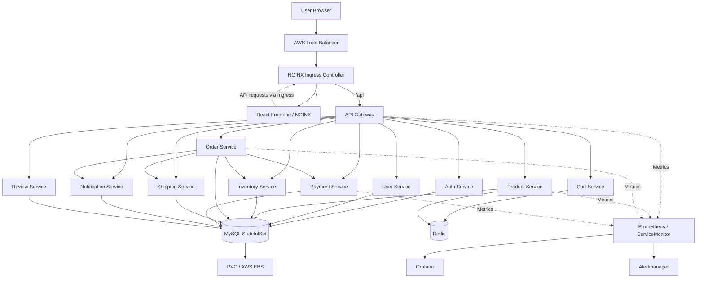

# 🛒 CloudCart — E-Commerce Microservices Platform

      

## 📖 Project Overview

CloudCart is a production-style, full-stack e-commerce platform deployed on an AWS kOps Kubernetes cluster. It demonstrates independently deployed microservices, centralized API routing, persistent database storage, Redis caching, horizontal autoscaling, and observability using Prometheus and Grafana.

The platform consists of 10 business microservices, an API Gateway, and a React frontend, packaged as 12 application container images.

## 🏗️ Architecture



All backend services expose metrics for monitoring; selected connections are shown for readability.

## ✨ Key Features

- Product catalog, category filtering, search and admin product creation.
- User registration, login and profile management.
- Redis-backed shopping cart and product caching.
- Inventory validation, order orchestration and mock payment processing.
- Shipment tracking, notifications and product reviews.
- Kubernetes readiness/liveness probes, resource requests and limits.
- Persistent MySQL storage using StatefulSet, PVC and AWS EBS.
- Optional CPU-based HPA and Prometheus alert rules.
- Nine-panel Grafana monitoring dashboard.

## 🛠️ Technology Stack

| Layer | Technologies |
|---|---|
| Frontend | React, NGINX |
| Backend | Node.js, Express.js |
| Database | MySQL, separate logical schemas |
| Cache | Redis |
| Containerization | Docker, Docker Hub |
| Orchestration | Kubernetes, kOps, Helm |
| Cloud | AWS, Load Balancer, EBS |
| Networking | NGINX Ingress, API Gateway |
| Monitoring | Prometheus, Grafana, Alertmanager |
| Configuration | ConfigMaps, Secrets, PVC, HPA |

## 🧩 Microservices

| Service | API route | Responsibility |
|---|---|---|
| Auth | `/api/auth` | Registration and login |
| User | `/api/users` | User profiles |
| Product | `/api/products` | Product catalog and caching |
| Inventory | `/api/inventory` | Stock management |
| Cart | `/api/cart` | Redis-backed cart |
| Order | `/api/orders` | Order orchestration |
| Payment | `/api/payments` | Mock payments |
| Shipping | `/api/shipping` | Shipment and tracking |
| Notification | `/api/notifications` | Order notifications |
| Review | `/api/reviews` | Product reviews |
| API Gateway | `/api/*` | Central API routing |
| Frontend | `/` | React shopping interface |

## 📂 Repository Structure

```text
cloudcart-ecommerce-microservices/
├── README.md
├── database/
│   └── init.sql
├── frontend/
│   ├── Dockerfile
│   ├── nginx.conf
│   ├── package.json
│   ├── index.html
│   └── src/
│       ├── main.jsx
│       └── style.css
├── k8s/
│   ├── namespace.yaml
│   ├── secret.yaml
│   ├── mysql.yaml
│   ├── redis.yaml
│   ├── backend.yaml
│   ├── frontend.yaml
│   ├── ingress.yaml
│   ├── hpa.yaml
│   └── monitoring.yaml
├── scripts/
│   └── build-push.sh
├── services/
│   ├── api-gateway/
│   ├── auth-service/
│   ├── user-service/
│   ├── product-service/
│   ├── inventory-service/
│   ├── cart-service/
│   ├── order-service/
│   ├── payment-service/
│   ├── shipping-service/
│   ├── notification-service/
│   └── review-service/
└── values-monitoring.yaml
```

## 🚀 Deployment Guide

### 1. Prerequisites

An operational AWS kOps cluster, kubectl, Docker, Helm, Docker Hub account, sufficient node CPU/memory, and a working EBS-backed storage class.

```bash
kubectl get nodes
kubectl cluster-info
docker version
helm version
kubectl get storageclass
```

### 2. Build and push Docker images

From the repository root:

```bash
docker login
export DOCKER_USER=vikasjagtap9696
export IMAGE_TAG=v1
chmod +x scripts/build-push.sh
./scripts/build-push.sh
```

Ensure the image references in `k8s/backend.yaml` and `k8s/frontend.yaml` match your registry and image tags.

### 3. Install NGINX Ingress Controller

The original lab uses ingress-nginx. Use a compatible chart version for reproducing the lab; for new production deployments, choose a maintained ingress or Gateway API implementation.

```bash
helm repo add ingress-nginx https://kubernetes.github.io/ingress-nginx
helm repo update
helm upgrade --install ingress-nginx ingress-nginx/ingress-nginx \
  --namespace ingress-nginx --create-namespace
kubectl get svc -n ingress-nginx
```

### 4. Deploy CloudCart

Configure your own database and JWT secrets before deployment. Do not commit real credentials.

```bash
kubectl apply -f k8s/namespace.yaml
kubectl apply -f k8s/secret.yaml
kubectl apply -f k8s/mysql.yaml
kubectl apply -f k8s/redis.yaml
kubectl apply -f k8s/backend.yaml
kubectl apply -f k8s/frontend.yaml
kubectl apply -f k8s/ingress.yaml
kubectl get pods,svc,ingress,pvc -n ecommerce
```

Ensure any ConfigMaps referenced by the manifests are created and MySQL initialization completes.

### 5. Access the application

```bash
export APP_URL="http://$(kubectl get svc ingress-nginx-controller -n ingress-nginx -o jsonpath='{.status.loadBalancer.ingress[0].hostname}')"
echo "$APP_URL"
curl "$APP_URL/api/products"
```

The product API was successfully tested through the AWS Ingress LoadBalancer and returned 10 products.

## 📊 Monitoring and Observability

Install the Prometheus Operator stack with the supplied monitoring values after replacing any default credentials:

```bash
helm repo add prometheus-community https://prometheus-community.github.io/helm-charts
helm repo update
helm upgrade --install kube-prometheus-stack prometheus-community/kube-prometheus-stack \
  -n monitoring --create-namespace -f values-monitoring.yaml
kubectl apply -f k8s/monitoring.yaml
kubectl get servicemonitor,prometheusrule -n ecommerce
```

The ServiceMonitor selects backend services labeled `cloudcart-monitor=true` and scrapes `/metrics` every 15 seconds. Ensure the Prometheus selectors discover the monitor and rules in the `ecommerce` namespace.

Access monitoring tools in separate terminals:

```bash
kubectl port-forward -n monitoring svc/kube-prometheus-stack-grafana 3000:80
```

```bash
kubectl port-forward -n monitoring svc/kube-prometheus-stack-prometheus 9090:9090
```

Grafana: `http://localhost:3000` · Prometheus: `http://localhost:9090`

### Grafana Dashboard

Dashboard name: **CloudCart E-Commerce Microservices Dashboard**

| Panel | Visualization | PromQL |
|---|---|---|
| Service Health | Stat | `up{namespace="ecommerce"}` |
| API Gateway Request Rate | Time series | `sum(rate(api_gateway_http_requests_total[2m]))` |
| API Gateway Status Codes | Time series | `sum by (status) (rate(api_gateway_http_requests_total[2m]))` |
| Product Service Traffic | Time series | `sum(rate(product_service_http_requests_total[2m]))` |
| Total Orders Created | Stat | `sum(order_service_orders_created_total)` |
| Successful Payments | Stat | `sum(payment_service_success_total)` |
| Failed Payments | Stat | `sum(payment_service_failed_total)` |
| Pod CPU Usage | Time series | `sum by (pod) (rate(container_cpu_usage_seconds_total{namespace="ecommerce",container!="",image!=""}[5m]))` |
| Pod Memory Usage (MiB) | Time series | `sum by (pod) (container_memory_working_set_bytes{namespace="ecommerce",container!="",image!=""}) / 1024 / 1024` |

Counters can reset on pod restart. CPU and memory panels require kubelet/cAdvisor scraping.

### 🚨 Prometheus Alerts

| Alert | Condition |
|---|---|
| CloudCartServiceDown | Scrape target down for 1 minute |
| CloudCartHighApiGateway5xx | More than 1 server error per second for 1 minute |
| CloudCartPaymentFailures | More than 3 failures in 5 minutes per series, sustained for 1 minute |
| CloudCartPodRestarts | More than 2 restarts in 10 minutes per series, sustained for 1 minute |
| CloudCartHighMemoryUsage | Pod memory above 400 MiB for 2 minutes |
| CloudCartHighCPUUsage | Pod CPU above 0.4 cores for 2 minutes |

## 📈 Horizontal Pod Autoscaling

The optional HPA manifests target API Gateway, Product Service and Order Service, with 2–5 replicas and 60% average CPU utilization. Install a compatible Metrics Server first and verify CPU resource requests are configured.

```bash
kubectl top nodes
kubectl apply -f k8s/hpa.yaml
kubectl get hpa -n ecommerce
```

## 🧪 API Testing

Use a disposable test environment and test credentials only.

```bash
curl "$APP_URL/api/products"
curl -X POST "$APP_URL/api/auth/register" \
  -H 'Content-Type: application/json' \
  -d '{"name":"Demo User","email":"demo@example.com","password":"DemoOnly123!"}'
curl -X POST "$APP_URL/api/auth/login" \
  -H 'Content-Type: application/json' \
  -d '{"email":"demo@example.com","password":"DemoOnly123!"}'
curl "$APP_URL/api/inventory/1"
```

Additional demo flow: add items to cart, place an order, test mock payment success (`1111`) and failure (`0000`), inspect notifications and submit a review. Use the actual registered user ID and any authentication required by the application.

Generate product traffic:

```bash
for i in {1..50}; do
  curl -s -o /dev/null -w '%{http_code}\n' "$APP_URL/api/products"
  sleep 1
done
```

## 🔧 Useful Kubernetes Commands

```bash
kubectl get pods -n ecommerce -o wide
kubectl get svc,ingress,pvc -n ecommerce
kubectl logs -n ecommerce deploy/api-gateway
kubectl logs -n ecommerce deploy/product-service
kubectl rollout status deployment/frontend -n ecommerce
kubectl get hpa -n ecommerce
```

### Troubleshooting

- **ImagePullBackOff:** verify registry image names, tags and credentials.
- **Pending pods:** check node resources, scheduling events and PVC binding.
- **API errors:** inspect Ingress rules, API Gateway logs and service endpoints.
- **No monitoring data:** check ServiceMonitor selectors, service labels, named ports and Prometheus targets.
- **Missing database tables:** MySQL initialization scripts normally run only on first initialization. Back up data before any storage reset.

## 🔄 Rolling Updates

```bash
docker build -t "$DOCKER_USER/cloudcart-frontend:v2" frontend
docker push "$DOCKER_USER/cloudcart-frontend:v2"
kubectl set image deployment/frontend -n ecommerce \
  frontend="$DOCKER_USER/cloudcart-frontend:v2"
kubectl rollout status deployment/frontend -n ecommerce
```

## 📸 Project Screenshots

Add screenshots of the CloudCart frontend, Kubernetes workloads, Grafana dashboard and Prometheus alerts here when available.

## 🎯 Learning Outcomes

Microservices architecture, AWS cloud infrastructure, Docker image management, Kubernetes stateful workloads, API routing, persistent storage, caching, autoscaling, PromQL, observability and troubleshooting.

## 🔐 Production Considerations

This is a production-style learning project, not a certified production-ready commerce system. Use HTTPS, least-privilege IAM, secure secret management, database backups, maintained networking components and appropriate access controls before real-world deployment. Payments are simulated. Remove unused AWS resources after the lab to avoid ongoing charges.

## 👨‍💻 Author & Acknowledgements

**Vikas Jagtap** — Project implementation and deployment

- GitHub: [vikasjagtap9696](https://github.com/vikasjagtap9696)
- Project design and training guidance: **Reyaz Sir — Naresh IT, Hyderabad**

---

⭐ If you find this project useful, consider starring the repository.
