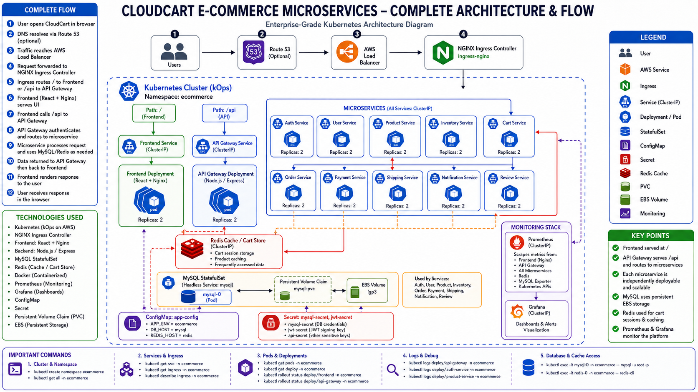
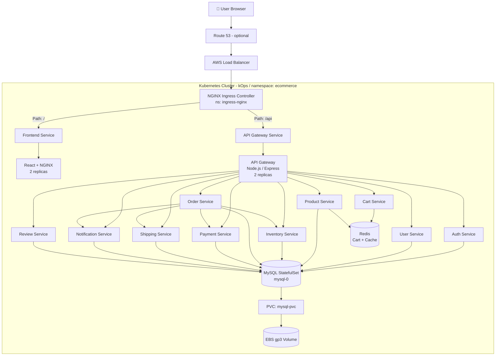
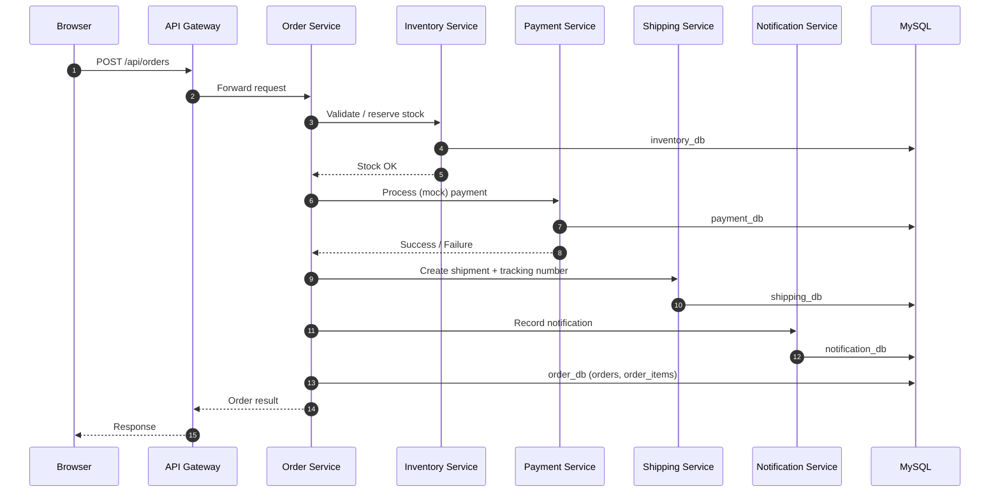
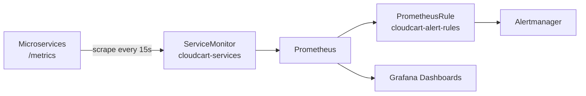

# CloudCart – E-Commerce Microservices Platform
 
> A production-style, full-stack e-commerce platform built with **React, Node.js microservices, MySQL, Redis**, deployed on a **kOps Kubernetes cluster (AWS)** with **NGINX Ingress, Prometheus and Grafana**.
 
**Designed by:** Reyaz Sir
**Project type:** Full-stack Kubernetes-based microservices project
 
---
 
## Table of Contents
 
1. [Overview](#1-overview)
2. [Architecture Diagram](#2-architecture-diagram)
3. [Microservices](#3-microservices)
4. [Technologies Used](#4-technologies-used)
5. [Project Structure](#5-project-structure)
6. [Prerequisites](#6-prerequisites)
7. [Setup & Deployment](#7-setup--deployment)
8. [Access the Application](#8-access-the-application)
9. [API Testing](#9-api-testing)
10. [Verify Data (MySQL & Redis)](#10-verify-data-mysql--redis)
11. [Monitoring (Prometheus & Grafana)](#11-monitoring-prometheus--grafana)
12. [Updating a Service](#12-updating-a-service)
13. [Useful Commands](#13-useful-commands)
14. [Troubleshooting](#14-troubleshooting)
15. [Demo Flow](#15-demo-flow)
16. [Resume Summary & Interview Explanation](#16-resume-summary--interview-explanation)
---
 
## 1. Overview
 
CloudCart provides a real e-commerce experience: product categories (Mobiles, Laptops, Electronics, Accessories), search, cart drawer, admin product creation, order placement, mock payments, reviews and notifications.
 
- The **React frontend** (served by NGINX) calls backend APIs under `/api`.
- The **API Gateway** receives all `/api` requests and routes them to the correct microservice.
- **11 backend services** are independently deployed (2 replicas each).
- **MySQL** runs as a StatefulSet with PVC/EBS storage; each service has its own schema.
- **Redis** is used for cart storage and product caching.
- **Prometheus + Grafana** provide metrics, dashboards and alerts.
> **Cluster sizing tip:** Use bigger machines for kOps, master and nodes (e.g. *flexi large*, 50 GB disk, admin role) so all workloads and the monitoring stack fit comfortably.
 
---
 
## 2. Architecture Diagram
 
### 2.1 Complete architecture (image)
 

 
### 2.2 Request flow
 

 
### 2.3 Routing & database map
 
```
Browser
  |
  v
React Frontend
  |
  v
NGINX Ingress
  |
  v
API Gateway
  |
  |-- /api/auth ----------> Auth Service ----------> MySQL auth_db
  |-- /api/users ---------> User Service ----------> MySQL user_db
  |-- /api/products ------> Product Service -------> MySQL product_db + Redis cache
  |-- /api/inventory -----> Inventory Service -----> MySQL inventory_db
  |-- /api/cart ----------> Cart Service ----------> Redis
  |-- /api/orders --------> Order Service ---------> MySQL order_db
  |                         |--> Inventory Service
  |                         |--> Payment Service
  |                         |--> Shipping Service
  |                         |--> Notification Service
  |
  |-- /api/payments ------> Payment Service -------> MySQL payment_db
  |-- /api/shipping ------> Shipping Service ------> MySQL shipping_db
  |-- /api/notifications -> Notification Service --> MySQL notification_db
  |-- /api/reviews -------> Review Service --------> MySQL review_db
 
Monitoring:
  Prometheus -> ServiceMonitor -> All backend /metrics endpoints
  Grafana    -> Prometheus
```
 
### 2.4 Order placement sequence
 

 
### 2.5 Monitoring flow
 

 
---
 
## 3. Microservices
 
| Service | Purpose | Storage |
|---|---|---|
| **Frontend** | React + NGINX UI | – |
| **API Gateway** | Central routing layer for `/api/*` | – |
| **Auth Service** | User registration and login (JWT) | `auth_db` |
| **User Service** | User profile management | `user_db` |
| **Product Service** | Product catalog, admin product creation | `product_db` + Redis cache |
| **Inventory Service** | Product stock management | `inventory_db` |
| **Cart Service** | Cart storage | Redis |
| **Order Service** | Order orchestration | `order_db` |
| **Payment Service** | Mock payment processing | `payment_db` |
| **Shipping Service** | Shipment and tracking creation | `shipping_db` |
| **Notification Service** | Order notifications | `notification_db` |
| **Review Service** | Product reviews | `review_db` |
 
### API reference (via the API Gateway)
 
The gateway strips the `/api` prefix and forwards to the service (e.g. `/api/products` → `product-service /products`).
 
| Method | Endpoint | Service |
|---|---|---|
| POST | `/api/auth/register`, `/api/auth/login` | Auth |
| GET | `/api/auth/validate` | Auth |
| GET / PUT | `/api/users/:userId` | User |
| GET / POST | `/api/products`, GET `/api/products/:id` | Product |
| GET | `/api/inventory/:productId` | Inventory |
| POST | `/api/inventory/upsert`, `/api/inventory/reserve` | Inventory |
| GET | `/api/cart/:userId` | Cart |
| POST | `/api/cart/add`, `/api/cart/clear` | Cart |
| POST | `/api/orders` | Order |
| GET | `/api/orders/:userId`, `/api/orders/detail/:orderId` | Order |
| POST | `/api/payments/pay` (card `0000` = FAILED, anything else = SUCCESS) | Payment |
| GET | `/api/payments/:orderId` | Payment |
| POST | `/api/shipping/create` | Shipping |
| GET | `/api/shipping/:orderId` | Shipping |
| POST | `/api/notifications/send` | Notification |
| GET | `/api/notifications` (latest 50) | Notification |
| POST | `/api/reviews` | Review |
| GET | `/api/reviews/product/:productId` | Review |
 
### Runtime configuration (generated manifests)
 
- Backend pods get `MYSQL_HOST=mysql`, `MYSQL_USER=root`, `MYSQL_PASSWORD` and `JWT_SECRET` (from Secret `mysql-secret`), and `REDIS_HOST=redis`.
- Probes: readiness `GET /ready` (checks MySQL / Redis), liveness `GET /health`, on port 3000.
- Metrics: every service exposes `/metrics`, e.g. `api_gateway_http_requests_total`, `product_service_http_requests_total`, `order_service_orders_created_total`, `payment_service_success_total`, `payment_service_failed_total`.
- MySQL: StatefulSet `mysql` with a 5Gi PVC (`mysql-data-mysql-0`, backed by EBS), schema loaded from ConfigMap `mysql-initdb`.
- The architecture diagram also shows a ConfigMap `app-config`; the generated manifests use plain env vars instead, so treat that box as illustrative.
Each backend container listens on port **3000**; its Kubernetes Service exposes port **80**. All services expose `/health`, readiness and Prometheus `/metrics` endpoints.
 
---
 
## 4. Technologies Used
 
- **Frontend:** React, NGINX
- **Backend:** Node.js, Express.js
- **Data:** MySQL (StatefulSet), Redis
- **Containers:** Docker (multi-stage build for frontend)
- **Orchestration:** Kubernetes, kOps on AWS
- **Networking:** NGINX Ingress Controller, AWS Load Balancer, Route 53 (optional)
- **Config:** ConfigMap, Secret, PersistentVolumeClaim, EBS Volume
- **Scaling:** HorizontalPodAutoscaler (HPA), Metrics Server
- **Monitoring:** Prometheus, Grafana, Alertmanager (kube-prometheus-stack)
**Kubernetes features used:** Deployments, Services (ClusterIP), StatefulSet, ConfigMaps, Secrets, Ingress, readiness/liveness probes, resource requests/limits, HPA, ServiceMonitor, PrometheusRule.
 
---
 
## 5. Project Structure
 
```
cloudcart-ecommerce-microservices/
├── README.md
├── database/
│   └── init.sql                 # creates 9 databases + tables + seed data
├── frontend/
│   ├── Dockerfile               # multi-stage: Node build -> NGINX
│   ├── index.html
│   ├── nginx.conf
│   ├── package.json
│   └── src/
│       ├── main.jsx
│       └── style.css
├── k8s/
│   ├── namespace.yaml
│   ├── mysql-secret.yaml        # Secret: mysql-secret (DB password + JWT secret)
│   ├── mysql-configmap.yaml     # ConfigMap: mysql-initdb (init.sql)
│   ├── mysql.yaml               # Headless Service + StatefulSet (5Gi PVC)
│   ├── redis.yaml               # Deployment + Service
│   ├── backend.yaml             # 11 Deployments + 11 Services
│   ├── frontend.yaml
│   ├── ingress.yaml
│   ├── monitoring-optional.yaml # ServiceMonitor (generated by the script)
│   ├── hpa.yaml                 # added manually (see section 7, step 6)
│   └── monitoring.yaml          # ServiceMonitor + alert rules (added manually, section 11)
├── scripts/
│   ├── build-push.sh
│   ├── deploy.sh
│   └── verify.sh
└── services/
    ├── api-gateway/             (Dockerfile, package.json, server.js)
    ├── auth-service/
    ├── user-service/
    ├── product-service/
    ├── inventory-service/
    ├── cart-service/
    ├── order-service/
    ├── payment-service/
    ├── shipping-service/
    ├── notification-service/
    └── review-service/
```
 
`create_cloudcart.sh` generates the project (11 services, `init.sql` with 9 databases, React frontend, Dockerfiles, Kubernetes manifests and helper scripts). `hpa.yaml` and `monitoring.yaml` are not generated by the script; they are included in this repo / README and applied manually.
 
---
 
## 6. Prerequisites
 
- A running **kOps Kubernetes cluster** on AWS (`kubectl get nodes` works)
- Amazon Linux 2023 admin machine
- Docker Hub account
Install the required tools:
 
```bash
sudo dnf update -y
sudo dnf install -y git wget tar gzip docker tree
sudo systemctl enable docker
sudo systemctl start docker
docker version
```
 
Install Helm:
 
```bash
curl -fsSL -o get_helm.sh https://raw.githubusercontent.com/helm/helm/main/scripts/get-helm-3
chmod 700 get_helm.sh
./get_helm.sh
helm version
```
 
Verify Kubernetes:
 
```bash
kubectl get nodes
kubectl get pods -A
kubectl cluster-info
```
 
---
 
## 7. Setup & Deployment
 
### Step 1 – Generate the project
 
```bash
vi create_cloudcart.sh      # paste the script contents
bash create_cloudcart.sh
cd cloudcart-ecommerce-microservices
tree
```
 
The script reads these optional environment variables (defaults in brackets):
 
| Variable | Default |
|---|---|
| `PROJECT` | `cloudcart-ecommerce-microservices` |
| `DOCKER_USER` | `trainerreyaz` |
| `IMAGE_TAG` | `v1` |
| `NAMESPACE` | `ecommerce` |
| `MYSQL_ROOT_PASSWORD` | `root123` (lab default, change it) |
| `JWT_SECRET` | `cloudcart-jwt-secret` (lab default, change it) |
 
> **Warning:** the script runs `rm -rf` on the `PROJECT` folder before regenerating it, so any edits you made inside will be lost. Export your own `DOCKER_USER` *before* running it so the manifests get your image names, e.g. `DOCKER_USER=myuser bash create_cloudcart.sh`.
 
### Step 2 – Build and push Docker images
 
```bash
docker login
export DOCKER_USER=<your-dockerhub-username>
export IMAGE_TAG=v1
 
./scripts/build-push.sh
```
 
This builds and pushes 12 images: `cloudcart-api-gateway`, `-auth-service`, `-user-service`, `-product-service`, `-inventory-service`, `-cart-service`, `-order-service`, `-payment-service`, `-shipping-service`, `-notification-service`, `-review-service`, `-frontend` (all tagged `:v1`).
 
### Step 3 – Install NGINX Ingress Controller
 
```bash
helm repo add ingress-nginx https://kubernetes.github.io/ingress-nginx
helm repo update
 
helm upgrade --install ingress-nginx ingress-nginx/ingress-nginx \
  --namespace ingress-nginx \
  --create-namespace
 
kubectl get pods -n ingress-nginx
kubectl get svc -n ingress-nginx
```
 
### Step 4 – Install Prometheus stack (optional but recommended)
 
Create `values-monitoring.yaml`:
 
```yaml
grafana:
  enabled: true
  adminUser: admin
  adminPassword: <choose-a-strong-password>
  service:
    type: ClusterIP
 
prometheus:
  prometheusSpec:
    retention: 7d
    scrapeInterval: 30s
    evaluationInterval: 30s
    serviceMonitorSelectorNilUsesHelmValues: false
    serviceMonitorNamespaceSelector: {}
    ruleSelectorNilUsesHelmValues: false
    ruleNamespaceSelector: {}
 
alertmanager:
  enabled: true
  alertmanagerSpec:
    alertmanagerConfigSelector: {}
    alertmanagerConfigNamespaceSelector: {}
 
kubeStateMetrics:
  enabled: true
 
nodeExporter:
  enabled: true
```
 
Install:
 
```bash
helm repo add prometheus-community https://prometheus-community.github.io/helm-charts
helm repo update
 
helm upgrade --install kube-prometheus-stack \
  prometheus-community/kube-prometheus-stack \
  --namespace monitoring \
  --create-namespace \
  --values values-monitoring.yaml
 
kubectl get pods -n monitoring
kubectl get crd | grep monitoring.coreos.com
```
 
### Step 5 – Deploy CloudCart
 
```bash
./scripts/deploy.sh
```
 
`deploy.sh` applies, in order: namespace -> `mysql-secret` -> `mysql-initdb` ConfigMap -> MySQL StatefulSet and Redis -> waits for MySQL rollout -> backend Deployments/Services -> frontend -> Ingress. Then check:
 
```bash
./scripts/verify.sh
kubectl get pods -n ecommerce
kubectl get svc -n ecommerce
kubectl get ingress -n ecommerce
```
 
### Step 6 – Install Metrics Server and HPA
 
```bash
kubectl apply -f https://github.com/kubernetes-sigs/metrics-server/releases/latest/download/high-availability-1.21+.yaml
 
kubectl top nodes          # apply HPA only if this works
kubectl apply -f k8s/hpa.yaml
kubectl get hpa -n ecommerce
```
 
`k8s/hpa.yaml` (not generated by the script, use the file provided with this README) defines HPAs for `api-gateway`, `product-service` and `order-service` (min 2, max 5 replicas, 60% CPU target).
 
> The generated Deployments start with **1 replica** each (requests `50m` CPU / `64Mi` memory, limits `500m` / `512Mi`). The 2-replica layout in the architecture diagram is reached through the HPA or `kubectl scale`. HPA only works when CPU requests are set, which the generated manifests do.
 
### Step 7 – Verify everything
 
```bash
kubectl get all -n ecommerce
kubectl get endpoints api-gateway auth-service product-service notification-service -n ecommerce
```
 
Expected workloads: `mysql-0`, `redis`, `frontend`, `api-gateway`, `auth-service`, `user-service`, `product-service`, `inventory-service`, `cart-service`, `order-service`, `payment-service`, `shipping-service`, `notification-service`, `review-service`.
 
---
 
## 8. Access the Application
 
Get the load balancer hostname:
 
```bash
kubectl get svc -n ingress-nginx
```
 
Open the `EXTERNAL-IP` (ELB hostname) in your browser:
 
```
http://<your-elb-hostname>.ap-south-1.elb.amazonaws.com
```
 
Register → Login → you will see the greeting for your user.
 
---
 
## 9. API Testing
 
```bash
export APP_URL=http://<your-elb-hostname>
```
 
> Note: do not repeat `http://` twice in the URL.
 
| Action | Command |
|---|---|
| List products | `curl $APP_URL/api/products` |
| Check inventory | `curl $APP_URL/api/inventory/1` |
| View cart | `curl $APP_URL/api/cart/1` |
| Load notifications | `curl $APP_URL/api/notifications` |
| Load reviews | `curl $APP_URL/api/reviews/product/1` |
 
**Register user**
 
```bash
curl -X POST $APP_URL/api/auth/register \
  -H "Content-Type: application/json" \
  -d '{"name":"demo","email":"demo@example.com","password":"password123"}'
```
 
**Login**
 
```bash
curl -X POST $APP_URL/api/auth/login \
  -H "Content-Type: application/json" \
  -d '{"email":"demo@example.com","password":"password123"}'
```
 
**Add to cart**
 
```bash
curl -X POST $APP_URL/api/cart/add \
  -H "Content-Type: application/json" \
  -d '{"userId":1,"productId":1,"name":"Laptop Pro 15","price":89999,"quantity":1}'
```
 
**Place a successful order** (card ending `1111`)
 
```bash
curl -X POST $APP_URL/api/orders \
  -H "Content-Type: application/json" \
  -d '{"userId":1,"cardNumber":"1111","items":[{"productId":1,"name":"Laptop Pro 15","price":89999,"quantity":1}]}'
```
 
**Place a failed-payment order** (card `0000`)
 
```bash
curl -X POST $APP_URL/api/orders \
  -H "Content-Type: application/json" \
  -d '{"userId":1,"cardNumber":"0000","items":[{"productId":2,"name":"Wireless Mouse","price":1499,"quantity":1}]}'
```
 
**Add a review**
 
```bash
curl -X POST $APP_URL/api/reviews \
  -H "Content-Type: application/json" \
  -d '{"productId":1,"userId":1,"rating":5,"comment":"Excellent laptop"}'
```
 
---
 
## 10. Verify Data (MySQL & Redis)
 
**MySQL**
 
```bash
# Get the root password
kubectl get secret mysql-secret -n ecommerce \
  -o jsonpath="{.data.MYSQL_ROOT_PASSWORD}" | base64 -d; echo
 
# Connect
kubectl exec -it mysql-0 -n ecommerce -- mysql -uroot -p
```
 
```sql
SHOW DATABASES;
USE product_db;      SELECT * FROM products;
USE inventory_db;    SELECT * FROM inventory;
USE order_db;        SELECT * FROM orders;  SELECT * FROM order_items;
USE payment_db;      SELECT * FROM payments;
USE shipping_db;     SELECT * FROM shipments;
USE notification_db; SELECT * FROM notifications;
```
 
**Redis**
 
```bash
kubectl exec -it deploy/redis -n ecommerce -- redis-cli
```
 
```
KEYS *
GET cart:1
```
 
---
 
## 11. Monitoring (Prometheus & Grafana)
 
### Install the stack with a public Grafana LoadBalancer
 
```bash
helm upgrade --install kube-prometheus-stack prometheus-community/kube-prometheus-stack \
  -n monitoring --create-namespace \
  --set grafana.service.type=LoadBalancer \
  --set prometheus.prometheusSpec.serviceMonitorSelectorNilUsesHelmValues=false \
  --set prometheus.prometheusSpec.podMonitorSelectorNilUsesHelmValues=false \
  --set prometheus.prometheusSpec.ruleSelectorNilUsesHelmValues=false \
  --set prometheus.prometheusSpec.serviceMonitorNamespaceSelector.any=true \
  --set prometheus.prometheusSpec.ruleNamespaceSelector.any=true
 
kubectl get pods -n monitoring
kubectl get svc -n monitoring kube-prometheus-stack-grafana
```
 
Get the Grafana admin password:
 
```bash
kubectl get secret kube-prometheus-stack-grafana -n monitoring \
  -o jsonpath="{.data.admin-password}" | base64 -d
```
 
Username: `admin`
 
### Label services for scraping
 
Prometheus scrapes only services labelled `cloudcart-monitor=true`.
 
```bash
kubectl label svc api-gateway auth-service user-service product-service \
  inventory-service cart-service order-service payment-service \
  shipping-service notification-service review-service \
  -n ecommerce cloudcart-monitor=true --overwrite
 
kubectl get svc -n ecommerce --show-labels
```
 
> Do **not** label `mysql`, `redis` or `frontend` unless you also deploy exporters for them.
 
### Apply ServiceMonitor and alert rules
 
The script only generates `k8s/monitoring-optional.yaml` (ServiceMonitor). Use `k8s/monitoring.yaml` (provided with this README), which contains the same ServiceMonitor **plus** the PrometheusRule alerts:
 
```bash
kubectl apply -f k8s/monitoring.yaml
kubectl get servicemonitor -n ecommerce
kubectl get prometheusrule -n ecommerce
```
 
Expected: `cloudcart-services` and `cloudcart-alert-rules`.
 
**Alerts defined**
 
| Alert | Condition |
|---|---|
| `CloudCartServiceDown` | Any target `up == 0` for 1m (critical) |
| `CloudCartHighApiGateway5xx` | API Gateway 5xx rate > 1 |
| `CloudCartPaymentFailures` | > 3 failed payments in 5m |
| `CloudCartPodRestarts` | > 2 restarts in 10m |
| `CloudCartHighMemoryUsage` | Pod memory > 400 MB |
| `CloudCartHighCPUUsage` | Pod CPU > 0.4 cores |
 
### Access Prometheus
 
```bash
kubectl port-forward -n monitoring svc/kube-prometheus-stack-prometheus 9090:9090 --address 0.0.0.0
```
 
Open `http://<KOPS-IP>:9090` (or `http://localhost:9090`) and try:
 
```promql
up{namespace="ecommerce"}
api_gateway_http_requests_total
product_service_http_requests_total
order_service_orders_created_total
payment_service_success_total
payment_service_failed_total
sum(rate(api_gateway_http_requests_total[2m]))
sum(rate(product_service_http_requests_total[2m]))
```
 
### Access Grafana (port-forward alternative)
 
```bash
kubectl port-forward svc/kube-prometheus-stack-grafana -n monitoring 3000:80
```
 
Open `http://localhost:3000`.
 
### Dashboard panels
 
Create **Dashboards → New → New Dashboard → Add Visualization** with the Prometheus data source (use the *Code* query mode).
 
| # | Panel | Type | Query |
|---|---|---|---|
| 1 | CloudCart Service Health | Stat | `up{namespace="ecommerce"}` |
| 2 | API Gateway Request Rate | Time series | `sum(rate(api_gateway_http_requests_total[2m]))` |
| 3 | API Gateway Status Codes | Time series | `sum by (status) (rate(api_gateway_http_requests_total[2m]))` |
| 4 | Product Service Traffic | Time series | `sum(rate(product_service_http_requests_total[2m]))` |
| 5 | Total Orders Created | Stat | `order_service_orders_created_total` |
| 6 | Successful Payments | Stat | `payment_service_success_total` |
| 7 | Failed Payments | Stat | `payment_service_failed_total` |
| 8 | Pod CPU Usage | Time series | `sum by (pod) (rate(container_cpu_usage_seconds_total{namespace="ecommerce", container!="", image!=""}[5m]))` |
| 9 | Pod Memory Usage (MB) | Time series | `sum by (pod) (container_memory_working_set_bytes{namespace="ecommerce", container!="", image!=""}) / 1024 / 1024` |
 
Save as **CloudCart E-Commerce Microservices Dashboard**.
 
**If a panel shows "No data"**, generate traffic:
 
```bash
for i in {1..50}; do curl -s $APP_URL/api/products > /dev/null; done
```
 
### Test alerts
 
```bash
for i in {1..5}; do
  curl -s -X POST $APP_URL/api/orders \
    -H "Content-Type: application/json" \
    -d '{"userId":1,"cardNumber":"0000","items":[{"productId":2,"name":"Wireless Mouse","price":1499,"quantity":1}]}'
  echo
done
```
 
Open `http://localhost:9090/alerts` – you should see **CloudCartPaymentFailures**.
 
---
 
## 12. Updating a Service
 
Example – updating the frontend:
 
```bash
vi frontend/src/main.jsx            # make a change
 
docker build -t <dockerhub-user>/cloudcart-frontend:v2 frontend
docker push <dockerhub-user>/cloudcart-frontend:v2
 
kubectl set image deployment/frontend -n ecommerce \
  frontend=<dockerhub-user>/cloudcart-frontend:v2
 
kubectl rollout status deployment/frontend -n ecommerce
```
 
The same steps apply to any microservice (use its folder under `services/`).
 
---
 
## 13. Useful Commands
 
```bash
# Pods, services, ingress
kubectl get pods -n ecommerce -o wide
kubectl get svc -n ecommerce
kubectl get ingress -n ecommerce
kubectl describe pod <pod-name> -n ecommerce
 
# Logs
kubectl logs -n ecommerce deploy/api-gateway
kubectl logs -n ecommerce deploy/auth-service
kubectl logs -n ecommerce deploy/product-service
kubectl logs -n ecommerce deploy/order-service
 
# Restart / watch rollout
kubectl rollout restart deployment/product-service -n ecommerce
kubectl rollout status deployment/product-service -n ecommerce
 
# Scale
kubectl scale deployment product-service -n ecommerce --replicas=3
kubectl get hpa -n ecommerce
```
 
---
 
## 14. Troubleshooting
 
**Pods stuck in `ImagePullBackOff`**
 
```bash
kubectl describe pod <pod-name> -n ecommerce
docker pull $DOCKER_USER/cloudcart-product-service:v1
 
# If the YAML still has the placeholder
grep -R DOCKER_USER_PLACEHOLDER k8s/
sed -i "s|DOCKER_USER_PLACEHOLDER|$DOCKER_USER|g" k8s/backend.yaml
sed -i "s|DOCKER_USER_PLACEHOLDER|$DOCKER_USER|g" k8s/frontend.yaml
kubectl apply -f k8s/backend.yaml
kubectl apply -f k8s/frontend.yaml
```
 
**MySQL pod running but tables missing**
 
Init scripts run only on first initialization. If the PVC already exists, they won't run again. For a full reset:
 
```bash
kubectl delete statefulset mysql -n ecommerce
kubectl delete pvc mysql-data-mysql-0 -n ecommerce
kubectl apply -f k8s/mysql.yaml
```
 
**Frontend opens but APIs fail**
 
```bash
kubectl logs -n ecommerce deploy/api-gateway
kubectl describe ingress cloudcart-ingress -n ecommerce
kubectl port-forward svc/api-gateway -n ecommerce 8081:80
curl http://localhost:8081/api/products
```
 
**Prometheus does not show CloudCart metrics**
 
```bash
kubectl get servicemonitor -n ecommerce
kubectl describe servicemonitor cloudcart-services -n ecommerce
kubectl get svc -n ecommerce --show-labels        # expect cloudcart-monitor=true
 
kubectl port-forward svc/product-service -n ecommerce 8082:80
curl http://localhost:8082/metrics
```
 
---
 
## 15. Demo Flow
 
1. Open the frontend
2. Register a user
3. Log in
4. Load products
5. Check stock
6. Add a product to the cart
7. Show the cart stored in Redis
8. Place an order
9. Order Service calls Inventory Service
10. Order Service calls Payment Service
11. Payment Service stores the transaction
12. Shipping Service creates a tracking number
13. Notification Service records a message
14. Check MySQL data
15. Check Redis data
16. Open the Grafana dashboard
17. Generate payment failures
18. Show the Prometheus alert firing
19. Restart or scale a Kubernetes service
---
 
## 16. Resume Summary & Interview Explanation
 
**Resume summary**
 
Built and deployed CloudCart, a production-style e-commerce microservices platform on Kubernetes using React, Node.js, MySQL, Redis, Docker, NGINX Ingress, Prometheus, and Grafana. Implemented an API Gateway pattern to route frontend requests to independent backend microservices including Auth, Product, Inventory, Cart, Order, Payment, Shipping, Notification, and Review services. Deployed MySQL as a StatefulSet with persistent storage and Redis for cart/session caching. Configured Kubernetes Deployments, Services, Secrets, ConfigMaps, Ingress, readiness/liveness probes, resource limits, and monitoring with Prometheus and Grafana.
 
**Interview explanation**
 
I built a production-style e-commerce microservices platform on Kubernetes. Users reach the React frontend through an AWS Load Balancer and NGINX Ingress. The frontend calls backend APIs through an API Gateway, which routes traffic to independent Node.js microservices (Auth, Product, Inventory, Cart, Order, Payment, Shipping, Notification, Review). MySQL runs as a StatefulSet with a separate database per service, and Redis handles cart storage and product caching. The Order Service coordinates Inventory, Payment, Shipping and Notification to complete an order. Each service exposes health, readiness and Prometheus metrics endpoints. The platform uses Deployments, Services, Secrets, ConfigMaps, Ingress, resource limits, probes and HPAs. Prometheus scrapes metrics via ServiceMonitor, Grafana visualizes them, and PrometheusRule alerts detect service failures and payment issues.
 
---
 
### Key Points
 
- Frontend served at `/`; API Gateway serves `/api` and routes to microservices
- Each microservice is independently deployable and scalable
- MySQL uses persistent EBS storage; Redis handles cart sessions and caching
- Prometheus and Grafana monitor the whole platform
> **Security note:** The sample passwords in the original notes (e.g. Grafana `admin123`, MySQL `root123`) are for lab use only. Change them and keep real secrets out of Git for any non-demo environment.
 